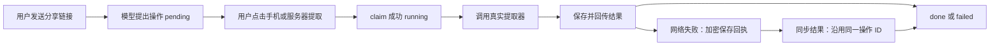

# 0.7.0 更新入口

以下是0.5.0历史实现记录。个人服务器访问、平台授权归属、数据迁移和最新API以 [0.7.0技术文档](account-server-access.md) 为准。

# 音频 Agent、记忆与手机号账号

更新日期：2026-10-02。实现依据：GetAudio `91a3dd4`（Android 0.5.0，versionCode 13）。本文记录该版本已实现的行为；后续文档提交不代表增加了新的应用功能。

## 使用步骤

1. 安装 `GetAudio-0.5.0-91a3dd4-debug.apk`，进入「我的」，点击头像。
2. 首次使用选择「首次使用，注册账号」，输入自己的中国大陆手机号与至少 8 位密码，确认密码后注册；已有账号直接登录。
3. 返回「我的 → 音频助手」，发送抖音或 B站分享文本，例如「帮我提取这个链接：〔分享链接〕」。
4. 助手生成待确认提取卡片后，点击「手机提取」或「服务器提取」。成功音频加入手机音频库，失败也记录结果。
5. 可以继续问「刚才为什么失败了？」或「根据我的偏好推荐音频」。模型结合本次会话结果、当前偏好和候选曲目回答。
6. 发送「记住，我喜欢完整的钢琴曲」可得到偏好建议，点击「填入偏好，确认后保存」，核对后再点击「确认保存偏好」。也可以直接在偏好输入框填写、保存。

账号登录与「抖音 / B站平台登录」分别管理：前者关联个人会话和偏好，后者提供平台 Cookie。登录 GetAudio 不会自动登录抖音。手机号统一规范化为 `+86`，同一号码的不同写法对应同一账号；注册接口拒绝重复号码。

当前使用手机号＋密码，没有短信归属验证、验证码登录和忘记密码流程。新账号不会自动认领旧访客偏好或平台凭证。服务器音频库仍是共享库，账号隔离的是会话、记忆和账号名下的平台凭证；手机本地音频仍留在当前设备。

## 模型与提取器各自做什么

模型负责理解请求、提出提取操作、推荐库内曲目、解释已有诊断及提出偏好建议。实际音频下载和封装沿用现有提取器：

- 手机：`TrackRepository.extract()` → `DirectExtractor` → 本地文件和 Room 音频记录。
- 服务器：`TrackRepository.extractViaServer()` → `POST /extract` → `pipeline.extract()` → 服务器文件和任务记录 → 手机下载、入库。

Agent 始终需要连接 GetAudio 服务端，才能使用账号记忆与服务端持有的模型 Key；在 Agent 中选择「手机提取」时，音频提取仍由手机直接访问平台完成。普通「提取」页的手机直提取可独立使用，不要求登录 GetAudio。

模型不能生成任意下载地址。工具输入只能取自当前或最近会话里用户提供的受支持平台链接；一个操作对应一个链接。确认执行模式由按钮决定，模型不能自动替用户切换到服务器。HTTP 403 只说明请求被拒绝，不能据此断定一定是 Cookie、IP 或签名问题；Agent 不能解除平台限制。

## 一次操作的状态与证据



`claim` 用数据库条件更新保证操作只能从 `pending` 进入 `running` 一次；重复确认返回 409，不会再次调用提取器。结果写入与工具事件追加在同一事务完成，同一结果重复回传返回已保存记录，不同结果不能覆盖。

| 证据来源 | 含义 |
|---|---|
| `device_reported` | 手机报告的成功或失败；不能称为服务器已核验 |
| `server_verified` | 服务器模式的成功结果，已匹配同用户、同输入链接、同曲目 ID 的成功提取任务及有效曲目记录；标题取服务器记录 |

服务器模式的失败结果也由手机报告，不会标记为 `server_verified`。收到工具结果后，下一次对话会把近期结果提供给模型；本版没有无限自动重试或后台自主执行循环。

手机回传失败时，完成结果加密存入设备私有目录，重新进入助手后可点击「同步提取结果」，不会重新下载。若进程在提取完成但尚未保存回执时终止，状态可能停在 `running`：先检查音频库，需要重试时重新发送链接生成新操作。本版没有任务租约、超时接管或自动恢复下载机制。

## 记忆设计

借鉴 `WorkPlan/agent-memory` 的身份边界、版本控制、证据来源和幂等思路，采用现有 SQLite；没有复制其服务或引入 PostgreSQL、向量数据库、embedding 和语义检索。

| 内容 | 保存与读取方式 |
|---|---|
| 会话上下文 | 用户、助手、工具事件按会话保存；模型最多读取近期 16 条事件 |
| 长期偏好 | 用户明确确认保存；读取当前未删除版本，最多 50 条 |
| 变更历史 | 创建、修改、逻辑删除都追加 `AgentMemoryVersion`，不覆盖旧版本 |
| 曲目候选 | 从服务器近期最多 500 条有效曲目和手机提交的最多 100 条本地元数据筛选，给模型最多 20 条；回答引用最多 5 个有效 ID |
| 历史列表 | API 返回最近 30 个会话；手机当前展示最近 5 个入口 |
| 单会话回看 | 返回最近 100 条事件和最近 30 个操作；不是全部历史分页检索 |

普通对话不自动变成长期记忆。“记住”只允许模型提出建议，仍需用户核对保存。修改需提交 `expected_revision`，旧版本写入返回 409；删除后不再进入记忆检索，版本历史保留。删除会话会清除该会话的事件与操作，不删除音频和长期偏好。

## 模型配置与数据发送

服务端使用 Git 忽略的 `.env`：

```dotenv
ARK_API_KEY=<在服务器私下配置，不提交真实值>
GETAUDIO_ARK_MODELS=doubao-seed-2-0-mini-260428,doubao-seed-2-1-pro-260915
```

模型按列表顺序尝试；请求失败、结构无效、曲目 ID 越界或提取操作无合法链接时尝试下一个。每个模型请求超时取配置值和 35 秒的较小者。所有模型失败时明确降级：有可用链接时仍提供待确认提取入口，否则提示模型不可用。

模型接收提问、近期会话和工具结果、当前偏好、曲目候选元数据与可用分享链接。不上传音频文件、账号密码或会话令牌。明显的 Key、Cookie、密码赋值以及含用户名/密码的 URL 会被拒绝；这是输入检查，不是保证任意形式的敏感信息都能被识别。用户不应在聊天或偏好中粘贴凭据。

Key 不写入源码或 APK。两个配置模型在 2026-10-02 已用当前 Key 真实调用并取得有效结构化回答；这不能证明模型目录里的其他模型均可调用，也不保证以后持续可用。

## HTTP 接口

部署中的 nginx Basic 设备凭据与账号令牌是两层身份：Basic 放在 `Authorization`，账号令牌放在 `X-GetAudio-Session`，不能相互替代。新 Agent 从账号令牌推导用户身份，不接受请求体指定 `user_id`。

| 方法 | 路径 | 请求或用途 |
|---|---|---|
| POST | `/account/register` | `phone`、`password`；创建账号与登录会话 |
| POST | `/account/login` | `phone`、`password`；登录原账号 |
| GET | `/account/me` | 读取当前账号，需要账号令牌 |
| POST | `/account/logout` | 撤销当前令牌，幂等 |
| POST | `/agent/v2/chat` | UUID `request_id`、可选 UUID `conversation_id`、`message`、可选 `local_tracks` |
| GET | `/agent/v2/conversations` | 当前账号最近会话 |
| GET | `/agent/v2/conversations/{cid}` | 当前账号拥有的会话及操作 |
| DELETE | `/agent/v2/conversations/{cid}` | 删除当前账号拥有的会话 |
| POST | `/agent/v2/actions/{aid}/claim` | `mode`：`phone` 或 `server`；确认操作，尚不执行下载 |
| POST | `/agent/v2/actions/{aid}/result` | 回传 `success`、可选 `track_id`、`title`、`diagnostic`；来源由服务端决定 |
| GET/POST/PUT/DELETE | `/agent/memories…` | 复用既有偏好接口；注册账号 ID 必须由同账号令牌授权 |

首条聊天可省略 `conversation_id`，服务端按账号和 `request_id` 生成稳定会话 ID。网络重试必须保留相同 `request_id` 和原请求内容：已完成则返回原回答；同编号不同内容、并发处理或此前中断返回 409。手机手动重新发送会生成新请求编号。

聊天返回 `conversation_id`、`answer`、`track_ids`、`model`、`memory_proposal` 和可空的 `action`。`model=null` 表示降级结果。操作的输入链接由服务端根据用户原始内容确定，不能通过结果接口改写。成功回传必须有 `track_id`；手机提取记录为负数 ID，服务器记录为正数 ID。

关键错误：401 账号未登录或过期（公网也可能先被 nginx 拒绝）、403 旧接口账号越权、404 会话/操作不存在或不属于当前账号、409 请求/版本/状态冲突、429 登录尝试过频繁、422 请求字段不合法。API 校验错误不回显输入的密码等原始字段。

## 数据与部署

新增表由启动时的 `init_db()` 创建，不修改旧音频表：

| 表 | 用途 |
|---|---|
| `app_users` | 唯一规范手机号、稳定账号 ID、带盐 scrypt 密码哈希 |
| `app_sessions` | 令牌 SHA-256、所属账号、到期时间 |
| `agent_conversations` | 会话所属账号 |
| `agent_events` | 对话和工具事件、请求编号与幂等记录 |
| `agent_actions` | 原始输入链接、确认模式、执行状态和结果 |
| `agent_memories` / `agent_memory_versions` | 既有当前偏好与追加版本表 |

会话令牌有效 30 天，退出撤销当前令牌；密码不保存在手机。手机通过 Keystore AES-GCM 加密令牌和待同步回执，令牌只发送到登录时绑定的服务器源及路径。账号登录要求 HTTPS，debug 回环开发地址例外。

注册和登录共用单进程、每来源 IP 五分钟 20 次的限制；nginx 覆盖 `X-Forwarded-For` 为真实来源，Uvicorn 仅信任其回环代理。多进程部署需要另行设计共享限流，不能把当前进程内计数当作全局限制。

升级前用 SQLite backup API 保存数据库一致快照，再更新代码、重启 `getaudio-api.service`。不要删除已有音频、数据库、平台凭证加密密钥或手机私有访问配置。备份包含新增账号/会话数据，应按原数据库的私有权限保管。手机号令牌鉴权不覆盖所有旧接口，共享音频与访客兼容接口继续依赖 nginx，不能直接开放 Uvicorn 到公网。

具体 HTTPS 入口、代理配置与已执行部署操作见 [部署记录](../deploy/tx-https/README.md)。

## 验证与后续验收

以下验证对应实现提交 `91a3dd4`，记录日期 2026-10-02：

- Python 138 项测试通过，覆盖手机号唯一性、退出撤销、账号隔离、请求与结果幂等、操作确认、服务器成功证据、敏感输入与模型后备；删除偏好和其他账号偏好不进入当前模型上下文。
- Android `assembleDebug`、`testDebugUnitTest` 通过，30 项 JVM 测试；签名验证成功，包名 `com.getaudio.app`，版本 0.5.0/code 13，APK 未包含真实 Ark Key。
- 两个配置模型均 HTTP 200、结构校验通过；临时隔离数据库完成真实多轮 Agent 请求，验证链接操作准备、读取偏好及偏好建议，没有触发真实视频下载。
- 服务端已加载 0.5.0；公网 HTTPS 健康检查成功，未授权账号请求返回 401；nginx 配置校验通过。

尚待真机验收：注册、退出及同号码再次登录；手机与服务器两种提取；再次进入会话查看真实结果；偏好保存/修改/删除；断网后的结果回传及进程重启恢复。测试和构建通过不能替代这些验收，也不代表所有抖音链接均可提取。
